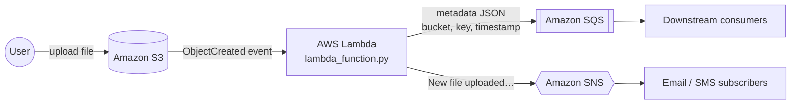

# S3 File Upload Notification System — Event-driven on AWS

When a file lands in an S3 bucket, a Lambda function fires automatically, pushes the file's metadata to an **SQS** queue for downstream processing, and sends a notification through **SNS** (email / SMS). No servers to manage.

📺 **Video walkthrough:** [YouTube](https://www.youtube.com/watch?v=fQV6pSN6zAU)

## 🏗️ Architecture

Diagram from the original build: [`Diagram Solution.PNG`](Diagram%20Solution.PNG) · Console screenshot: [`Capture.PNG`](Capture.PNG)

## 🔍 What the Lambda does

[`lambda_function.py`](lambda_function.py) loops over every S3 event record and:

1. extracts the **bucket name**, **object key** and **event time**
2. sends that metadata as JSON to **SQS**
3. publishes a human-readable message to an **SNS topic**

## 🛠️ AWS services

| Service | Role |
|---|---|
| S3 | Storage + event source |
| Lambda | Serverless processing |
| SQS | Durable queue for metadata |
| SNS | Fan-out notifications |
| IAM | Least-privilege role for Lambda |

## 🚀 Deploy it yourself

1. **SNS** — create a topic and subscribe your email.
2. **SQS** — create a standard queue.
3. **Lambda** — create a Python function, paste `lambda_function.py`, set your topic ARN and queue URL.
4. **IAM** — give the Lambda role `sqs:SendMessage` and `sns:Publish` on those resources.
5. **S3** — create a bucket and add an event notification (`All object create events`) targeting the Lambda.
6. Upload a file and check your inbox and the queue.

## 💡 What I learned

- Wiring S3 event notifications to Lambda
- Decoupling producers and consumers with SQS
- Fan-out notifications with SNS
- Scoping IAM permissions per service

## 👤 Author

**Muhammad Ahmad** — DevOps & Cloud Engineer · [GitHub](https://github.com/AhmadMughal-DS) · [LinkedIn](https://www.linkedin.com/in/ahmadai)
